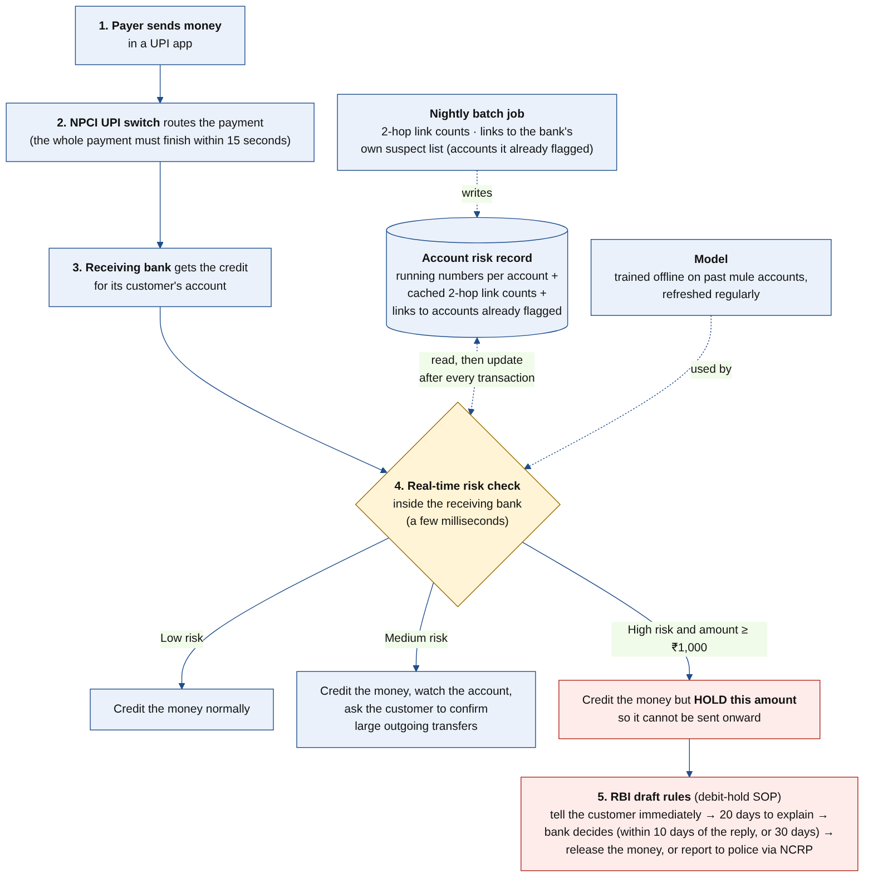
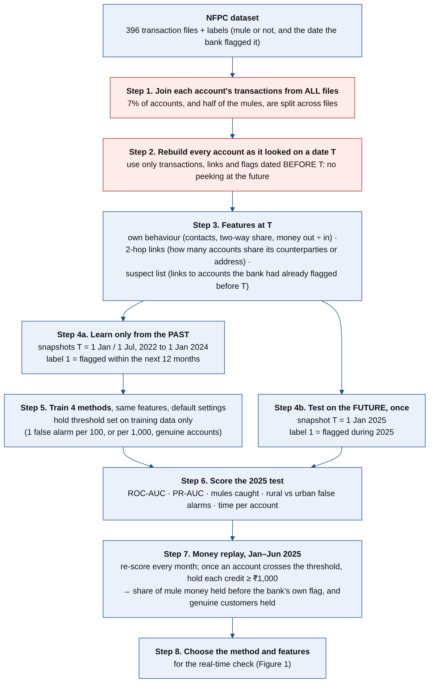

# Heimdall: stopping UPI mule-account money inside the bank, while the payment is happening

*Named after Heimdall, the Norse watchman who guards the gods' bridge, needs less sleep than a bird and hears the grass grow.*

**In one line:** when money arrives in an account that behaves like a *mule account*, the receiving bank holds that amount **during the UPI payment**, before it can be passed on, and then follows RBI's draft hold procedure.

**Status:** research prototype for the AIMIT FinTech Innovation Hackathon 2026, Track 1 (Digital Payments Fraud Detection & Prevention). The out-of-time benchmark is complete and reproducible (Sections 3–4 and the notebook). The live, transaction-by-transaction engine is the next stage.

---

## 1. The problem

- Fraudsters do not keep stolen money in their own accounts. They pass it through other people's accounts, called **mule accounts**, and move it on quickly.
- Banks usually act **after** a victim complains or the police report an account. By then the money has often already left.
- RBI's draft *Know Your Customer (Amendment) Directions, 2026* (11 Sep 2026; banks to implement by 1 Apr 2027) set out how banks may **temporarily hold** suspected mule transactions of ₹1,000 and above:
  - tell the customer immediately (or by the end of the next day);
  - give the customer 20 days to explain;
  - decide within 10 days of the reply (or 30 days from the hold if there is no reply);
  - release the money, or report to the police through NCRP-CFCFRMS;
  - hold for at most 60 days unless the police or another competent authority instruct otherwise.

  Holding a whole account is meant to be a last resort.
- **The open question:** can a bank decide, while the payment is still in progress, which incoming money is risky enough to hold? NPCI allows 15 seconds for the whole UPI payment.

## 2. What we propose



- **Where it sits:** inside the **receiving bank**, next to the fraud checks the bank already runs. Nothing changes at NPCI.
- **What it reads:** each account's **risk record**:
  - **running numbers**, updated by every transaction: how many different people it deals with, how many of those relationships go both ways, how much of the money it receives it sends on, and its recent activity;
  - **link numbers**, refreshed by a **nightly batch job**: how many other accounts share its counterparties or its address (two hops away), and its links to accounts the bank has **already flagged** (the bank's own suspect list). External lists, such as the I4C suspect registry or MuleHunter.AI scores, could use the same slot later.
- **What it decides:** a model, trained beforehand on past mule accounts, turns the record into a **risk score**. The bank then takes one of three actions:
  - **Low risk:** credit normally.
  - **Medium risk:** credit, watch the account, and ask the customer to confirm large outgoing transfers.
  - **High risk, and the amount is ₹1,000 or more:** credit but **hold this amount**. RBI's draft procedure starts, and a person reviews every hold.
- **What "real time" means here:** the *action* happens during the payment. The model and the link numbers are prepared in advance; scoring reads one record, so no graph model runs during the payment.

## 3. How we tested it



**The question:** *on 1 January 2025, using only what the bank knew before that date, which accounts will it flag as mules during 2025, and how much of the money flowing into them could have been held?*

**Why the test changed.** An earlier version of this benchmark split accounts at random (70% to learn from, 30% to test on). Review feedback pointed out that this lets the model learn from mules flagged in the same months as the ones it is tested on (most mules in this dataset were flagged in one sweep, April–June 2025). A bank never has that advantage: it must learn from the past and act on the future. So the benchmark is now **out-of-time**, and it measures **money held**, not only accounts flagged.

**The rules**
- **Learn only from the past:** account snapshots on 1 Jan and 1 Jul of 2022 and 2023, and on 1 Jan 2024. Label 1 = flagged within the next 12 months. Only snapshots whose 12-month outcome is known by 1 Jan 2025 are used.
- **Test once, on the future:** every labelled account as it looked on 1 Jan 2025; label 1 = flagged during 2025. Accounts the bank had already flagged are left out, and so are the 113 mules flagged in 2026 or later.
- **No peeking:** every feature uses only transactions, addresses and flags dated **before** the snapshot. Each account's transactions are joined from all files (about 7% of accounts, and half of the mules, are split across files).
- **Hold level fixed in advance:** chosen on the learning data only (out-of-fold scores, grouped by account) for 1 false alarm per 100 (or per 1,000) not-yet-flagged accounts.
- **Money replay:** January–June 2025. Accounts are re-scored at the start of each month with what was known that day; once an account crosses the hold level, every later credit of ₹1,000 or more is held until a person reviews it.
- **Fair comparison:** the same features and default settings for every method; 95% ranges from resampling the test accounts (or, for money, the mules).

**What was tested**

| | Size | Mules |
|---|---|---|
| Learning snapshots, 2022–2024 | 239,816 account-snapshots | 435 mule rows (319 different mules) |
| Test, 1 Jan 2025 | 92,877 accounts | 1,767 flagged during 2025 (1.9%) |
| Money replay, Jan–Jun 2025 | 152,520 credits of ₹1,000+ into 1,325 of those mules before their flag | ₹968 crore (synthetic amounts) |

Only 319 mules were flagged before 2025, so the models learn from few examples. That is realistic for a bank starting out, and it is the main reason the scores are lower than in the random-split version.

## 4. Results

### 4a. Four methods, same 28 features, tested once on 2025

| Method | ROC-AUC (95% range) | PR-AUC | Mules caught at 1 false alarm per 100 genuine | … per 1,000 | Mule money held when 1 in 100 genuine customers is held (95% range) | Time per account* |
|---|---|---|---|---|---|---|
| Simple rule (no learning) | 0.81 (0.81–0.82) | 0.08 | 3% | 0.2% | 3% | – |
| Logistic regression | 0.81 (0.79–0.82) | 0.15 | 14% | 4% | 11% (8–15%) | 1.3 ms |
| Random forest | 0.81 (0.80–0.82) | 0.17 | 19% | 6% | 15% (12–19%) | 55.3 ms |
| **LightGBM (chosen)** | **0.83 (0.81–0.84)** | **0.14** | **14%** | **4%** | **17% (13–22%)** | **1.0 ms** |
| *For comparison:* the same LightGBM tested the usual way (random 70/30 split of the 2025 accounts) | 0.91 ± 0.01 | 0.55 ± 0.03 | 64% | 19% | – | – |

\* Median time to score one account, measured on a 2-core cloud CPU (no GPU). The Kaggle notebook prints its own measurement.

**How to read the scores**
- **ROC-AUC:** take one mule and one genuine account at random. How often does the mule get the higher score? 0.5 is a coin toss; 1.0 is perfect.
- **PR-AUC:** of the accounts a method flags, how many are really mules? A coin toss scores about 0.02 here.
- **Mules caught at a fixed false-alarm level:** how many mules are found on 1 Jan 2025 if the bank accepts wrongly flagging 1 in 100 (or 1 in 1,000) genuine customers.
- **Money held at equal cost:** methods produce differently scaled scores, so we compare the money each holds when exactly 1 in 100 genuine customers gets a hold during the replay. Like the "caught" columns, this level is set on the test population, so it compares methods; it is not a level a bank could fix in advance (that is 4b).

### 4b. What a bank could actually do: the hold level fixed in advance

LightGBM, hold level set on 2022–2024 data for 1 false alarm per 100 accounts, replayed over January–June 2025:

| | Result |
|---|---|
| Mule money held (credits that arrived before the bank's own flag) | **23%** (95% range 18–28%) |
| Mules with a hold before the bank's own flag | 310 of 1,767 (18%), a median of **151 days earlier** |
| Genuine customers with at least one hold for a person to review | 1,514 of 91,110 (1.7%) |
| Share of genuine customers' credits of ₹1,000+ that were held | 1.3% |
| On 1 Jan 2025 alone | 193 mules and 505 genuine customers flagged (28% of alerts are real mules) |

At the stricter level (1 per 1,000): 5% of mule money held (3–7%), 88 mules, and 206 genuine customers (0.23%) with a hold.

**Thresholds drift.** The level was meant to hold 1 in 100 genuine customers; in 2025 it held 1.7 in 100. A bank should re-set the level every month from its review capacity (how many holds its staff can check), not trust a number fixed a year earlier.

### 4c. Do the two-hop links and the suspect list help?

| Features (LightGBM) | 2025 test ROC-AUC (95% range) | PR-AUC | Caught @1/100 | Caught @1/1000 | Money held when 1 in 100 genuine customers is held | Validation inside 2022–2024: ROC-AUC / PR-AUC |
|---|---|---|---|---|---|---|
| Own behaviour only (16 features) | 0.83 (0.82–0.85) | 0.15 | 14% | 2% | 13% (9–18%) | 0.81 / 0.022 |
| + two-hop links (24) | 0.81 (0.80–0.83) | 0.11 | 10% | 3% | 10% (7–14%) | 0.76 / 0.014 |
| **+ suspect list (28, chosen)** | 0.83 (0.81–0.84) | 0.14 | 14% | 4% | 17% (13–22%) | 0.80 / 0.013 |
| + PIN-code and branch shares (30, *not used*) | 0.78 (0.77–0.80) | 0.11 | 13% | 3% | 14% (10–19%) | 0.79 / 0.015 |
| Chosen, without any two-way information (25, check) | 0.79 (0.78–0.81) | 0.11 | 12% | 1% | 7% (5–10%) | 0.72 / 0.008 |

**Honest reading:** on this synthetic data the link features give **no consistent gain**. Own behaviour alone ties on the 2025 test and does slightly better on validation inside the learning years; the links do better only at the strictest setting (1 in 1,000) and on money held, with overlapping ranges. The validation set holds only about 170 mules, so small differences there are noise too.

We keep them in the chosen model because that was the plan before testing, they are computed nightly and cost nothing at scoring time, and they are where external suspect lists would plug in. Whether they help must be tested on real data, where shared phones and devices exist. Reasons they may not help here:
- phone numbers in the dataset are practically all unique (one shared pair), so there are no phone links;
- every recorded mobile-number update date falls in 2025, after the test date, so they cannot be used;
- about 65% of customers share an address with someone (at most 9 per address), which looks like a coincidence of the data generator rather than mule rings;
- counterparties are external IDs, so links through them are weak.

PIN-code and branch shares made results worse and could penalise whole neighbourhoods, so they are excluded whatever they score.

**Choosing a method inside the learning years** (own-behaviour features, validation on the 1 Jan 2024 snapshot):

| Method (own-behaviour features) | Validation ROC-AUC | PR-AUC | Caught @1/100 |
|---|---|---|---|
| Simple rule | 0.81 | 0.012 | 8% |
| Logistic regression | 0.84 | 0.013 | 7% |
| Random forest | 0.80 | 0.032 | 25% |
| LightGBM | 0.81 | 0.022 | 21% |

### 4d. What we learned

1. **Honest testing changes the picture.** The same model and features score PR-AUC 0.55 on a random split but 0.14 on the out-of-time test. Random splits flatter results.
2. **Learning beats the simple rule** at realistic false-alarm levels: 3% of mules caught by the rule against 14%–19% for the learned models.
3. **The methods are close.** Random forest ranks the very top best (PR-AUC 0.17); LightGBM has the best ROC-AUC and holds the most money at equal cost; the differences sit within the ranges. We use LightGBM because it scores one account in 1.0 ms against 55 ms.
4. **Holds can come early.** Mules that got a hold got it a median of 151 days before the bank's own flag.
5. **The model partly relies on a pattern that may be synthetic.** Removing all two-way information lowers ROC-AUC from 0.83 to 0.79 and money held from 17% to 7%. In this dataset almost every genuine contact is two-way, which is unlikely in a real bank.
6. **Fairness gap:** at the fixed level, genuine **rural** customers were wrongly flagged 0.66% of the time against 0.54% for urban customers (1.2×). Rural flags should go to a person before any hold is placed.

**What the model relies on** (share of LightGBM gain): `out_in_ratio` 8%, `upi_share` 8%, `in_last_month` 7%, `two_way_share` 7%, `active_days` 6%, `txn_per_day` 5%, `money_in` 5%, `money_out` 5%. All of the top features describe the account's own behaviour.

**Data checks (possible traps in the data)**
- **Impossible dates:** 323 accounts have an opening date *after* 1 Jan 2025 even though they transacted before it, and 4,318 were "opened" after their first transaction. These accounts are mules far more often (33% and 10%, against 2% overall), which cannot happen in a real bank, so it looks like a planted trap. Account age is therefore **not used at all**.
- **Dormant accounts:** 26% of mules had no transaction in the 30 days before 1 Jan 2025, against 4% of genuine accounts. *Caution:* the organisers deliberately planted genuine "dormant then reactivated" accounts as a trap (one of the challenge's red-herring groups, as reported by the [DhanRakshak](https://github.com/shivangiS04/DhanRakshak) submission), so this signal may not hold on harder test sets.
- **Not used because they record the bank's own actions:** account status, freeze and unfreeze dates, and KYC dates. They would leak the answer.

## 5. Speed and scale

- **Speed:** scoring one account takes about 1.0 ms (LightGBM, measured above). Updating an account's running numbers is a handful of additions per transaction.
- **Link numbers:** computed by a nightly batch job, not during the payment. Rebuilding every account's features for one date takes about 2 seconds for the roughly 150,000 active accounts here, working from monthly summary tables on a 2-core machine. Crores of accounts would need a standard data-processing job; that cost is **not yet measured**.
- **Scale:** UPI processed 24.07 billion transactions in September 2026, about 9,300 per second on average. Each bank checks only its own customers, so this load is naturally divided among banks.
- **Open questions:** the end-to-end timing of the full transaction-by-transaction engine, and the memory cost of keeping risk records for crores of accounts (for example in Redis).

## 6. What others already do

- **Mastercard Consumer Fraud Risk (UK, 2023):** real-time scoring of bank-to-bank payments using links to mule accounts, used by nine UK banks. This confirms the approach is mainstream.
- **Brazil, Pix (Nov 2021):** the receiving institution may block funds received by an individual for up to **72 hours** on suspected fraud, and must tell the customer. This is the closest precedent for "hold the amount when it lands".
- **United Kingdom (Oct 2024):** the sending bank may delay an outgoing payment for up to **4 business days** on reasonable grounds of fraud, telling the customer. This is the precedent for "confirm before sending".
- **Public NFPC solutions:** [DhanRakshak](https://github.com/shivangiS04/DhanRakshak) reports AUC 0.9773 (public) and 0.9671 (private) on the competition leaderboard, and 0.9203 in its own held-out re-run (5-fold cross-validation, recorded in its `verified_metrics.json`). It builds features from each account's full history, including the months of mule activity, so it answers a different question from ours; the numbers are not like-for-like. Another public solution we examined uses the account's frozen status as an input, which records the bank's own action.
- **Open-source projects:** most "real-time UPI fraud" repositories use self-generated data and report untested latency. We followed the stronger practices: past-only data, an out-of-time test, a simple-rule baseline, results at fixed false-alarm levels, money held, and stated limitations.

## 7. Limitations (please read)

- **The data is synthetic** (RBIH NFPC). Patterns here, for example almost every genuine contact being two-way, may not hold in a real bank. Money figures are synthetic amounts, and a few large mules carry much of the money (the 100 largest hold 44% of it), hence the wide ranges.
- **Labels are the bank's own flags.** Most mules were flagged in one sweep (April–June 2025), only 319 were flagged before 2025, and any undetected mules count as genuine.
- **One test period (2025) and no tuning, by design.**
- **Monthly replay:** the live check would re-score at every credit, so it could act sooner, and could also raise more alerts.
- **Link features are untested on real data** (no real shared phones or devices here).
- **No live bank traffic.** Real-world validation needs a partner bank, and a production version would need the bank's own data, because the dataset licence is non-commercial.

## 8. Reproduce the results

1. Open the notebook on Kaggle: **https://www.kaggle.com/code/gokuljayachandran/heimdall-benchmark**, or upload `notebooks/heimdall_benchmark.ipynb` with **File → Import notebook**.
2. Attach the dataset `abhyudayrbih/rbih-nfpc-phase-2` and set Accelerator to *None*.
3. Click **Run All**. The full run takes about 25–35 minutes; for a quick trial, set `N_FILES = 20` (the numbers are then meaningless, but every step runs).
4. The notebook writes its outputs to `/kaggle/working`. The copies in `results/` come from the same notebook.

```
heimdall-upi/
├── README.md
├── LICENSE                                 MIT licence for the code
├── notebooks/heimdall_benchmark.ipynb      every step of Figure 2, with plain explanations
├── figures/                                Figure 1 and Figure 2
└── results/
    ├── heimdall_results.csv                one row per method / feature set (Sections 4a–4c)
    ├── results_detail.json                 every number, including 95% ranges
    ├── validation_2024.csv                 validation inside the learning years (Section 4c)
    ├── random_split_check.csv              the usual random-split result, for comparison
    ├── feature_importance.csv              what the final model relies on
    └── meta.json                           dataset counts (learning rows, test mules, mule money)
```

## 9. Data, licence, originality

- **Code:** MIT licence (see [`LICENSE`](LICENSE)).
- **Data:** RBIH × IIT Delhi National Fraud Prevention Challenge Phase-2 dataset (Kaggle), CC BY-NC-SA 4.0 (non-commercial). The data is not included in this repository and keeps its own licence. No confidential or real customer data is used anywhere in this project.
- **Originality:** this is our own work, submitted by **Gokul Jayachandran** (team **MARK XLVI**, gokuljai2006@gmail.com), Sri Sai Ram Engineering College, Chennai.

## References

1. RBI, Draft *Reserve Bank of India (Know Your Customer) Amendment Directions, 2026*, SOP for temporary debit holds, 11 Sep 2026.
2. NPCI, UPI-OC No. 214 (2025-26), "Reduction in response time of UPI transaction", 26 Apr 2025 (Request/Response Pay limit 15 s from 16 Jun 2025).
3. NPCI UPI statistics, September 2026: 24.07 billion transactions.
4. Mastercard, "Mastercard leverages its AI capabilities to fight real-time payment scams", 6 Jul 2023.
5. Banco Central do Brasil: preventive 72-hour block of Pix funds on suspected fraud, effective 16 Nov 2021 (as reported by InfoMoney, 29 Sep 2021).
6. UK Payment Services (Amendment) Regulations 2024: delay of outbound payments up to 4 business days (in force Oct 2024).
7. RBIH & IIT Delhi, NFPC Phase-2 dataset, Kaggle `abhyudayrbih/rbih-nfpc-phase-2`.
8. S. Singh, DhanRakshak, https://github.com/shivangiS04/DhanRakshak (README and `verified_metrics.json`).
